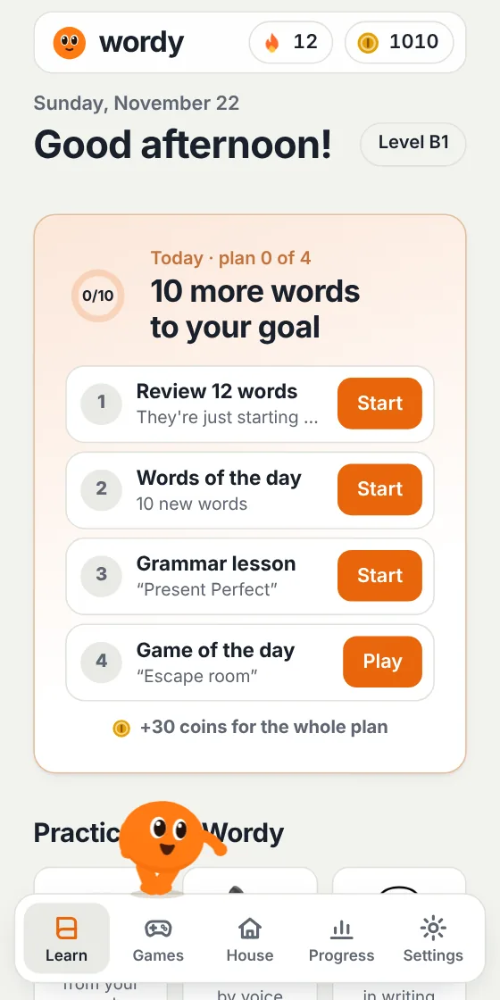
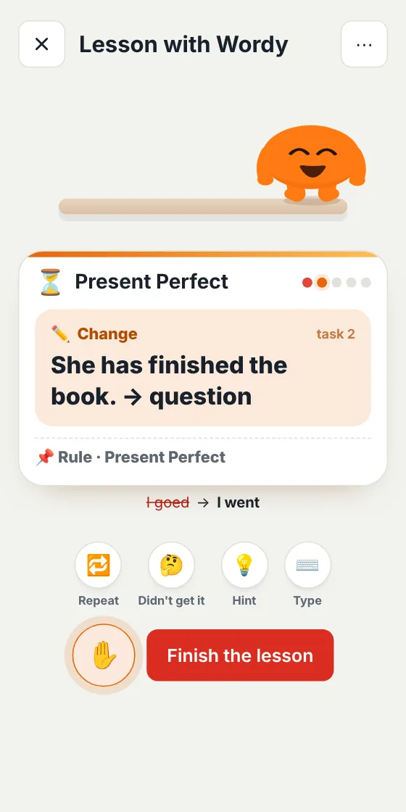
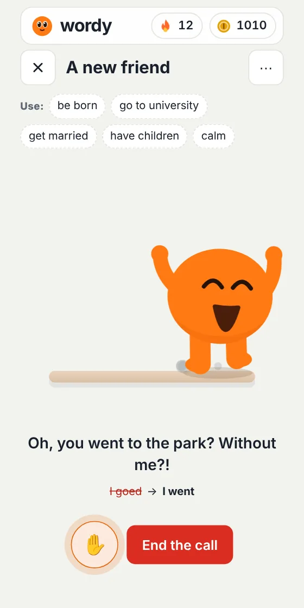
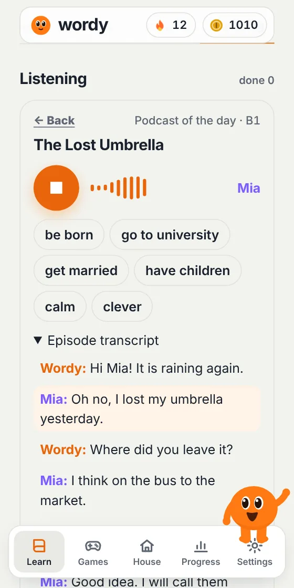

<div align="center">


# Wordy

### English comes alive

A free English-learning app with a living orange mascot.<br>
Vocabulary, 107 grammar lessons, IELTS and SAT prep, games and an AI tutor.

[](https://wordy-b5142.web.app/app.html)


[Features](#features) · [Screenshots](#screenshots) · [Tech](#tech) · [Run locally](#run-locally) · [Русская версия](#русская-версия)

</div>

---

## Screenshots

<div align="center">
<table>
<tr>
<td align="center"><br><sub>Home and Wordy</sub></td>
<td align="center"><br><sub>Grammar lesson</sub></td>
<td align="center"><br><sub>Speaking with AI</sub></td>
<td align="center"><br><sub>Listening</sub></td>
</tr>
</table>
</div>

## Why Wordy

Free apps give you words but rarely teach how to use them, and almost never teach grammar.
Wordy puts a full grammar course, a real memorisation system and exam prep in one place, and makes it fun to come back every day.

## Features

| | |
|---|---|
| 📚 **Vocabulary** | 5,000+ words with IPA, audio, examples and idioms, organised level → theme → small blocks |
| 🧠 **Memory system** | Spaced repetition. Reviews get harder as a word settles: choice → recall → typing → listening |
| 📖 **Grammar** | 107 lessons from A1 to C1. Theory first, then typed and multiple-choice practice, up to 3 stars |
| 🎯 **Exam prep** | IELTS Academic and SAT mock tests, listening and speaking practice |
| 🤖 **AI tutor** | Ask about any word or rule. A short spoken conversation estimates your CEFR level |
| 🎮 **Games** | Space typing shooter, English escape room, runner, letter-tetris, word game, crossword |
| 👩‍🏫 **For teachers** | Groups, homework with attachments, feedback, daily student codes |
| 🏆 **Progress** | Streaks, XP, coins, achievements, level-up celebrations |
| 🌗 **Comfort** | English and Russian interface, light and dark themes, works offline, reduced-motion support |

### Meet Wordy

Wordy is not an animated picture, it is a character that lives inside the interface. It is a procedural 2D figure with its own physics: it walks on the interface, jumps, falls, sleeps, follows your cursor with its eyes and reacts when you answer right or wrong.

## Tech

- **Front end:** HTML, CSS, JavaScript and React, built into a few static files
- **Back end:** Firebase Hosting, Authentication (Google, Microsoft, email), Firestore, Cloud Functions
- **AI:** Gemini through Firebase AI Logic for the tutor and the voice level test
- **PWA:** service worker and web manifest. Google Play listing assets are in `play-store/`
- **Mascot:** custom SVG renderer with a small physics engine: surfaces, jumps, squash and stretch, inverse-kinematics legs

## Run locally

```bash
git clone https://github.com/alimtszyu13-svg/Wordy.git
cd Wordy
```

Open `index.html` with any static server (for example the VS Code **Live Server** extension) and go to `/app.html`.
Deploying to Firebase Hosting is described in [`docs/DEPLOY.md`](docs/DEPLOY.md).

## Status

Closed beta, free for users. Feedback goes through **Settings → Feedback** in the app.

## Author

Built by **Alim Tszyu**, Bishkek, Kyrgyzstan, with Claude as a coding partner.

## License

MIT, see [`LICENSE`](LICENSE).

---

## Русская версия

**Wordy — английский оживает.** Бесплатное приложение для изучения английского с живым оранжевым талисманом, который ходит, прыгает и реагирует на твои ответы.

- Три направления: General English (A1 → C1), IELTS, SAT
- 5000+ слов с транскрипцией, озвучкой, примерами и идиомами
- 107 уроков грамматики: теория, затем практика, до 3 звёзд
- Интервальные повторения: слово возвращается всё сложнее, от выбора до ввода и аудирования
- Игры, ИИ-помощник, голосовой тест уровня, пробные IELTS и SAT, раздел для учителей
- Русский и английский интерфейс, светлая и тёмная темы, работает как приложение на телефоне

**Открыть:** https://wordy-b5142.web.app/app.html
