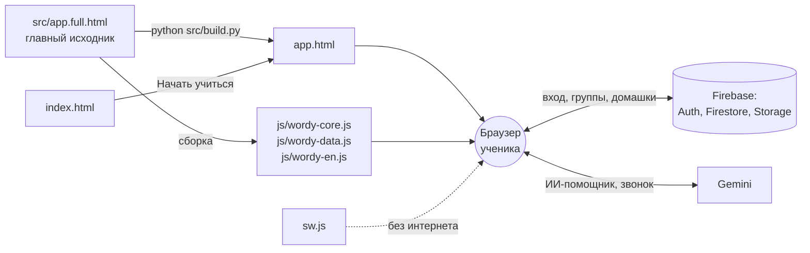

# Путеводитель по Wordy

Этот файл объясняет, как устроен Wordy: из чего он состоит, где что лежит и как вносить изменения. Читать можно по порядку или сразу открыть нужный раздел.

**Другие документы:**
- [CODE-MAP.md](CODE-MAP.md) — карта главного файла с кодом: где в нём слова, грамматика, игры, Ворди и т.д.
- [FIREBASE.md](FIREBASE.md) — сервер: вход, база данных, ИИ, ключи и безопасность.
- [DEPLOY.md](DEPLOY.md) — как выложить сайт в интернет.

## Содержание

1. [Wordy за две минуты](#1-wordy-за-две-минуты)
2. [Что где лежит](#2-что-где-лежит)
3. [Как всё связано](#3-как-всё-связано)
4. [Как вносить изменения](#4-как-вносить-изменения)
5. [Частые задачи](#5-частые-задачи)
6. [Английская версия](#6-английская-версия)
7. [Ворди: как он живёт](#7-ворди-как-он-живёт)
8. [Что можно убрать](#8-что-можно-убрать)
9. [Словарик](#9-словарик)

---

## 1. Wordy за две минуты

Wordy — это **сайт**, который ведёт себя как приложение. Сервера со своим кодом у него нет: это набор обычных файлов (HTML, JavaScript, картинки, звуки), которые Firebase Hosting раздаёт браузеру. Всё остальное работает уже в браузере ученика.

Там, где нужен сервер, Wordy пользуется готовыми сервисами Google Firebase:

| Что нужно | Чем сделано |
|---|---|
| Раздать файлы сайта | Firebase Hosting |
| Вход в аккаунт | Firebase Authentication (Google и email) |
| Хранить группы, домашки, сертификаты, отзывы | Cloud Firestore (база данных) |
| Хранить файлы домашек | Cloud Storage (нужен тариф Blaze) |
| ИИ-помощник, проверка эссе, голосовой звонок | Gemini через Firebase AI Logic |
| Напоминания на телефон | Cloud Functions (готово в коде, пока выключено) |

Прогресс ученика (выученные слова, звёзды, монеты) хранится **в браузере**, в localStorage, поэтому без аккаунта всё работает. Если человек вошёл в аккаунт, Wordy сам сохраняет копию прогресса в базе (`users/<id>/private/state`), и учёбу можно продолжить на другом устройстве. Аккаунт нужен также для групп с учителем, домашек и сертификатов.

Версия для Google Play — это не отдельное приложение, а «оболочка» вокруг того же сайта. Поэтому любая правка сайта сразу попадает и в приложение из Play.

## 2. Что где лежит

### Файлы, которые видят пользователи

| Файл или папка | Что это |
|---|---|
| `index.html` | Стартовая страница («лендинг»): что такое Wordy, кнопка «Начать учиться» |
| `app.html` | Само приложение. **Собирается автоматически** из `src/app.full.html`, руками не правится |
| `js/wordy-core.js` | Код приложения. Тоже собирается автоматически |
| `js/wordy-data.js` | Данные: слова, грамматика, тексты. Собирается автоматически |
| `js/wordy-en.js` | Словарь английского интерфейса. Собирается автоматически, грузится только в английском режиме |
| `privacy.html`, `terms.html` | Конфиденциальность и условия использования |
| `verify.html` | Проверка сертификата по коду |
| `404.html`, `offline.html` | «Страница не найдена» и «Нет интернета» |
| `site.css` | Общие стили для `index.html`, `verify.html`, `404.html`, `offline.html` |
| `sw.js` | Service worker: позволяет открывать Wordy без интернета и показывает напоминания |
| `manifest.webmanifest` | Паспорт приложения: название, иконки, цвета. Нужен, чтобы Wordy можно было установить на телефон |
| `icons/`, `favicon.ico` | Иконки |
| `img/` | Скриншоты для лендинга и README, картинка-превью для GitHub |
| `og.png` | Картинка превью ссылки в WhatsApp и Telegram |
| `audio/` | Озвучка: 40 файлов аудирования IELTS (10 тестов по 4 части) и 208 фраз экзаменатора для Speaking в `audio/sp/` |
| `.well-known/assetlinks.json` | Связь сайта с приложением в Google Play. Без него приложение из Play покажет адресную строку браузера |

### Файлы для работы (на сайт не попадают)

| Файл или папка | Что это |
|---|---|
| `src/app.full.html` | **Главный исходник.** Весь код приложения, стили, слова и грамматика в одном файле. Правки делаются здесь |
| `src/build.py`, `src/split.js`, `src/package.json` | Сборка: превращают `src/app.full.html` в `app.html` и `js/*.js` |
| `functions/` | Код напоминаний на сервере (Cloud Functions) |
| `firestore.rules` | Правила доступа к базе: кто что может читать и писать |
| `storage.rules` | Правила доступа к файлам домашек |
| `firebase.json`, `.firebaserc` | Настройки Firebase: какой проект, какие файлы выкладывать, как их кэшировать |
| `play-store/` | Тексты и картинки для страницы в Google Play. Подробно в `play-store/LISTING.md` |
| `docs/` | Эта документация |
| `README.md`, `LICENSE` | Лицо репозитория на GitHub и лицензия MIT |
| `.gitignore` | Что Git не берёт на GitHub (`node_modules`, архивы `.zip`, логи) |

Какие файлы не выкладываются на сайт, задано в `firebase.json` → `"ignore"`. Туда входят `src/`, `functions/`, `play-store/`, правила, `README.md` и все `.zip`.

## 3. Как всё связано



Что происходит, когда человек открывает Wordy:

1. Браузер загружает `app.html`. В нём стили, заставка, звуки и движок Ворди, а основной код приложения подключается тремя тегами `<script>`.
2. Ранний скрипт в начале `app.html` выбирает язык (сохранённый выбор, иначе язык браузера) и начинает фоном грузить Firebase.
3. Грузятся `js/wordy-data.js` (слова, грамматика), потом `js/wordy-core.js` (код). В английском режиме перед ними ещё `js/wordy-en.js`.
4. Код рисует интерфейс через React и запускает Ворди.
5. `sw.js` сохраняет файлы в кэше, и в следующий раз Wordy откроется даже без интернета.

К имени каждого файла в `app.html` приписано `?v=…`, например `wordy-core.js?v=6792c57059`. Это отпечаток содержимого. Когда файл меняется, отпечаток другой, и браузер скачивает свежую версию, а не берёт старую из кэша. Отпечатки ставит сборка, вручную их трогать не нужно.

## 4. Как вносить изменения

Главное правило: **правь `src/app.full.html`, а не `app.html` или `js/`.** Те файлы сборка перезапишет.

### Подготовка (один раз)

Нужны Python 3 и Node.js. Проверь в терминале VS Code:
```
python --version
node -v
```
Если `python` не находится, на Windows попробуй `py --version` и дальше пиши `py` вместо `python`.

Потом установи инструмент сборки:
```
cd src
npm install
cd ..
```

### Цикл правки

1. **Правка.** Открой `src/app.full.html`, найди нужное место через Ctrl+F (подсказки в [CODE-MAP.md](CODE-MAP.md)) и измени.
2. **Сборка.** В папке Wordy:
   ```
   python src/build.py
   ```
   Скрипт перезапишет `app.html` и `js/*.js` и напечатает их размеры. Если увидишь ошибку, ничего не выкладывай.
3. **Проверка у себя.** Открой `index.html` через Live Server и зайди в `/app.html`. Проверь, что твоя правка работает и ничего не сломалось. Открой консоль браузера (F12) и посмотри, нет ли красных ошибок.
4. **Выкладка:**
   ```
   npx firebase-tools deploy --only hosting
   ```
5. **Сохранение на GitHub:**
   ```
   git add .
   git commit -m "Что изменил, коротко"
   git push
   ```

Если что-то сломалось после выкладки, верни прошлую версию: `git log --oneline`, найди последний рабочий коммит, `git checkout <номер> -- src/app.full.html`, собери и выложи заново.

## 5. Частые задачи

### Поменять текст в интерфейсе
Найди текст через Ctrl+F в `src/app.full.html` и исправь. Если меняешь русский текст, в английском режиме он может остаться без перевода (см. [раздел 6](#6-английская-версия)).

### Добавить слово
Слова лежат в блоках вида:
```
U('basic','b110','A1','Colours','Цвета',`
red|/red/|красный|the colour of blood|The Kyrgyz flag is red.
```
Одна строка — одно слово, пять частей через `|`: слово, транскрипция, перевод, определение на английском, пример. Добавь строку в нужную тему.

> **Важно:** прогресс ученика привязан к паре «тема + слово» (например `b110-red`). Добавлять слова безопасно. Но если **переименовать** слово или **поменять код темы** (`b110`), у всех учеников пропадёт прогресс по нему.

### Поменять урок грамматики
Уроки лежат в объекте `GBOOK`, например `GBOOK.abc={ goal:..., sections:[...] }`. В каждом разделе (`h` — заголовок) лежат блоки: `'p'` — абзац, `'tbl'` — таблица, `'ex'` — примеры. Ищи по названию урока.

### Поменять реплики Ворди
Реплики, которые он говорит сам, лежат в движке Ворди (раздел WORDY ENGINE в [CODE-MAP.md](CODE-MAP.md)). Ищи по тексту фразы.

### Поменять текст в Google Play
`play-store/LISTING.md` — там всё, что вставляется в Play Console.

## 6. Английская версия

Код Wordy написан **по-русски**: все тексты интерфейса в исходнике на русском. В английском режиме небольшой слой перевода прямо перед отрисовкой заменяет каждую русскую строку на английскую по словарю.

Словари лежат в `src/app.full.html` между метками `/*I18N-BEGIN*/` и `/*I18N-END*/`:
- `I18N_D` — точные строки: «Начать» → «Start».
- `I18N_P` — шаблоны с меняющимися частями: «{0} слов в ответах» → «{0} words in your answers».
- `I18N_G` — тексты уроков грамматики.

При сборке они уходят в `js/wordy-en.js`, который грузится только в английском режиме, поэтому русские пользователи его не скачивают.

**Если добавил или изменил русский текст**, добавь в `I18N_D` пару `"русский текст": "English text"`. Иначе в английском режиме он покажется по-русски.

## 7. Ворди: как он живёт

Ворди — не картинка, а маленький физический движок. Он живёт в отдельном `<script>` в `src/app.full.html` и доступен в коде как `window.Wordy`.

- **Поверхности.** Ворди ходит по элементам с атрибутом `data-perch`, например по нижней панели. Чтобы он мог посидеть на новом блоке, добавь блоку `data-perch`.
- **Режимы.** `ground` — стоит или идёт по поверхности. `air` — прыгает или падает: работает гравитация, есть взлёт и приземление с «приплющиванием».
- **Отрисовка.** Каждый кадр функция `render()` заново рассчитывает тело, ноги (по суставам), руки и лицо и рисует их в SVG.
- **Действия** (`S.act`): споткнуться, покрутиться, чихнуть, отряхнуться и т.д. Время от времени он выбирает их сам.
- **Реакции на учёбу** идут из приложения через `W('react', ...)`, например радость после верного ответа.
- **Гардероб** (шапки, очки) — `window.WORDY_ITEMS` в отдельном скрипте рядом с движком.
- Если у человека включено «уменьшение движения», анимации упрощаются (`RM` в коде).

## 8. Что можно убрать

Ничего из этого я не удалял: решать тебе.

| Что | Почему кажется лишним |
|---|---|
| `wordy-engine.js` (в корне) | Старая версия движка для лендинга. Сейчас ни одна страница его не подключает, но он выкладывается на сайт |
| `img/screen-esc.webp`, `img/screen-gram.webp` | Ни одна страница и README их не используют |
| `wordy-audio-1.zip`, `wordy-audio-2.zip`, `wordy-audio-speaking.zip` | Архивы озвучки, около 50 МБ. На GitHub и на сайт не попадают (они в `.gitignore` и `firebase.json`), лежат только у тебя. Те же файлы уже распакованы в `audio/` |

Чтобы убрать `wordy-engine.js` и два скриншота аккуратно, через Git:
```
git rm wordy-engine.js img/screen-esc.webp img/screen-gram.webp
git commit -m "Убрал неиспользуемые файлы"
```
Если вдруг понадобятся, они останутся в истории Git. Если Git ответит `did not match any files`, значит файл не был в репозитории: просто удали его из папки.

## 9. Словарик

| Слово | Что значит |
|---|---|
| **Сборка (build)** | Превращение `src/app.full.html` в готовые файлы сайта |
| **Деплой (deploy)** | Выкладка файлов на Firebase Hosting, после этого их видят все |
| **Коммит (commit)** | Сохранённый снимок проекта в Git с подписью |
| **Пуш (push)** | Отправка коммитов на GitHub |
| **PWA** | Сайт, который можно установить на телефон как приложение |
| **Service worker** | Фоновый скрипт браузера (`sw.js`): кэш для работы без интернета и уведомления |
| **localStorage** | Хранилище в браузере. Там лежит прогресс ученика |
| **Firestore** | База данных Firebase: группы, домашки, сертификаты |
| **Правила (rules)** | Файлы `*.rules`: сервер Firebase по ним решает, кому что можно |
| **React** | Библиотека, которой нарисован интерфейс |
| **i18n** | Перевод интерфейса на другие языки |
| **CEFR** | Уровни языка A1–C1 |
| **Ключ API** | Строка `AIza…`, по которой Firebase узнаёт твой проект. Подробно в [FIREBASE.md](FIREBASE.md) |
